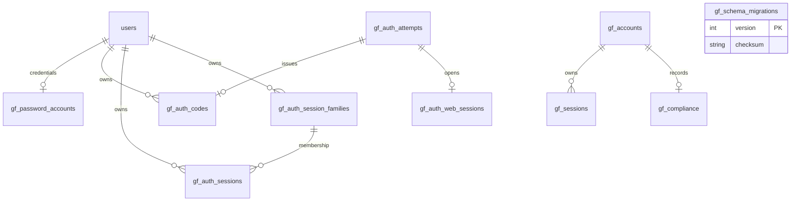

# Schema xác thực Green Farm 3

MySQL quản lý tài khoản, đăng nhập trong trình duyệt và phiên của ứng dụng. Dữ liệu nông trại tiếp tục nằm trong SQLite trên thiết bị. Website dùng Argon2id với salt riêng cho mỗi mật khẩu. Phiên của ứng dụng lưu SHA-256 của token ngẫu nhiên, thời điểm cấp/hết hạn và thời điểm thu hồi. Bảng nhóm phiên duy trì khả năng thu hồi phiên mới khi đăng xuất bằng cặp token cũ sau refresh.

## Bảng và quan hệ

| Bảng | Vai trò sau v5 |
|---|---|
| `users` | Danh tính Website, Facebook và Google. Lưu GAME_ID, provider, tên hiển thị và các mốc thời gian. |
| `gf_password_accounts` | Thông tin website gắn 1–1 với `users`. Username/email duy nhất, Argon2id PHC, trạng thái active/disabled và các mốc thời gian. Trạng thái active/disabled áp dụng cho tài khoản Website. Tài khoản OAuth dùng chính sách của nhà cung cấp và không cần bản ghi mật khẩu Website. |
| `gf_auth_attempts` | Yêu cầu xác thực, PKCE và trạng thái OAuth. |
| `gf_auth_codes` | Mã trao đổi một lần, lưu hash. Tham chiếu tài khoản và yêu cầu xác thực. |
| `gf_auth_web_sessions` | Cookie và CSRF của form, lưu hash. Tham chiếu yêu cầu xác thực. |
| `gf_auth_session_families` | Chủ sở hữu và biên thu hồi chung của chuỗi refresh. Thêm khóa duy nhất `(id, user_id)`. |
| `gf_auth_sessions` | Token hash, vòng đời phiên và khóa ngoại trực tiếp `(family_id, user_id)` đến nhóm phiên. |
| `gf_auth_session_links` | Bảng liên kết v3 đã được thay thế. Giữ tạm khi nâng cấp để đối chiếu và khôi phục. |
| `gf_accounts` | Danh tính ẩn danh cho endpoint tương thích legacy. |
| `gf_sessions` | Phiên legacy và dấu băm định danh phiên. |
| `gf_compliance` | Dữ liệu tuân thủ được endpoint legacy lưu cho tài khoản legacy. |
| `gf_schema_migrations` | Ledger lịch sử phiên bản và checksum. |



## SQL và quy trình triển khai

| Tệp | Cách sử dụng |
|---|---|
| [01_fresh_schema.sql](01_fresh_schema.sql) | Baseline v5 cho database mới, gồm ledger checksum thực của các migration 001–005. Bảng liên kết cũ không cần được tạo trực tiếp. |
| [005_session_family_membership.sql](../migrations/005_session_family_membership.sql) | Tương ứng với `02_upgrade_existing_schema.sql` theo quy ước migration có version và checksum của repo. |
| [03_verify_data.sql](03_verify_data.sql) | Báo cáo số hàng, dữ liệu trùng/orphan và khóa ngoại. Chỉ trả số liệu và metadata, không trả credential hoặc token. |
| [04_cleanup_unused_tables.sql](04_cleanup_unused_tables.sql) | Cleanup thủ công sau phê duyệt của quản trị viên. |
| [05_rollback_plan.md](05_rollback_plan.md) | Các bước khôi phục trước hoặc sau khi nhận lưu lượng v5. |

### Khởi tạo database mới

Tạo một schema MySQL 8.0.16+ hoặc 8.4 rỗng với charset `utf8mb4` và collation `utf8mb4_bin`. Dùng tài khoản quản trị qua cấu hình kết nối an toàn. Từ thư mục gốc repo:

```bash
mysql --login-path=greenfarm-dba --database=green_farm_new < backend/database/01_fresh_schema.sql
mysql --login-path=greenfarm-dba --database=green_farm_new < backend/database/03_verify_data.sql
```

Dùng batch mode mặc định để câu lệnh dừng khi gặp lỗi. Sau bước này, cấu hình backend đến schema mới. Chạy `npm run migrate` trong `backend` để đối chiếu các checksum, sau đó khởi động backend. Có thể dùng riêng luồng `npm run migrate` trên database rỗng nếu muốn để migration runner tạo toàn bộ lịch sử.

### Nâng cấp database hiện có

1. Dừng toàn bộ tiến trình backend đang ghi, kể cả bản v4. Chụp backup đầy đủ với ledger và kiểm tra đã khôi phục được sang database riêng. Ghi lại số hàng tài khoản, phiên và liên kết, cùng số tài khoản theo provider.
2. Trên bản phục hồi, chạy `npm run migrate` từ `backend` với cấu hình kết nối của bản thử nghiệm. Kiểm tra `03_verify_data.sql`, mọi `violations` và `archive_membership_mismatches` phải bằng `0`. Đối chiếu số hàng và thử đăng nhập, khôi phục phiên, refresh, logout và restart trên bản thử nghiệm.
3. Chạy `npm run migrate` trên database triển khai khi mọi tiến trình ghi đã dừng. Lặp lại đối chiếu trên database đích. V5 chỉ thêm membership trực tiếp cho phiên và ràng buộc cùng chủ sở hữu. V5 giữ nguyên hash, GAME_ID, thời hạn phiên và timestamp thu hồi.
4. Khởi động backend v5 và xác minh các endpoint xác thực. V5 ghi trực tiếp vào `family_id`. Khi backend chạy lại, các phiên mới sẽ không có hàng trong bảng liên kết lưu trữ.

Tài khoản chạy migration cần quyền tạo/sửa schema, tạo chỉ mục và tham chiếu khóa ngoại. Tài khoản runtime có thể dùng quyền DML theo thiết lập triển khai. Thông tin kết nối nên được cấp qua cấu hình môi trường hoặc MySQL login path.

### Cleanup do quản trị viên phê duyệt

Chờ xác nhận mọi phiên bản backend và dịch vụ phụ trợ đã chuyển sang v5, không còn đọc bảng liên kết và có backup phục hồi được. Sau khi kiểm tra dữ liệu và phê duyệt, dừng tiến trình ghi. Trong một kết nối MySQL dành riêng cho cleanup:

```sql
SET @greenfarm_cleanup_database = 'green_farm';
SET @greenfarm_cleanup_confirmation = 'BACKUP_RESTORED_AND_CUTOVER_VERIFIED';
SOURCE backend/database/04_cleanup_unused_tables.sql
```

Điền đúng tên database đã đối chiếu. Script sẽ kiểm tra ledger v5, khóa ngoại mới, bảng liên kết không có khóa ngoại trỏ vào và mọi dòng lưu trữ còn lại khớp membership trực tiếp. Kết quả `retired_link_table_present = 0` cho biết bảng đã vắng trong schema. Sau cleanup, chạy lại `03_verify_data.sql` và kiểm thử khôi phục phiên. Cơ chế dựng lại bảng liên kết từ các phiên hiện có được mô tả trong kế hoạch rollback.
