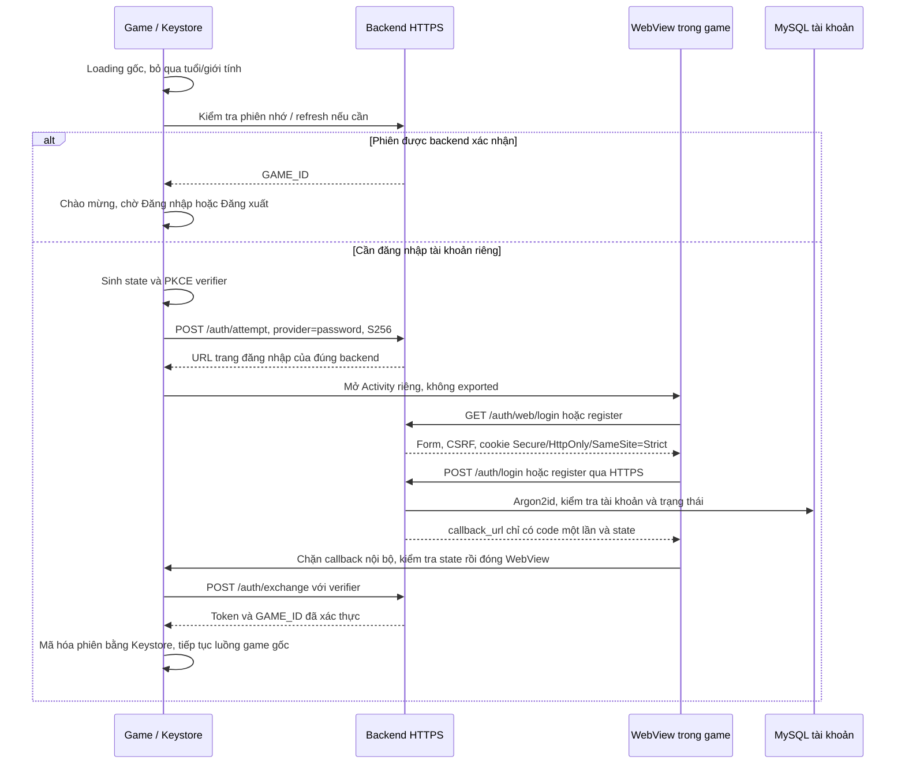

# Tài khoản riêng trong WebView Green Farm 3

Nút bên phải của box đăng nhập gốc chuyển từ Google sang tài khoản riêng trong
WebView. Nút Facebook tiếp tục dùng luồng OAuth chính thức qua trình duyệt;
Facebook không chạy trong WebView. Những tài khoản Google đã tạo vẫn được giữ
trong MySQL và các phiên hợp lệ cũ vẫn được nhận diện.

Hiện chưa có domain HTTPS được cung cấp. `AUTH_BASE_URL` vẫn để trống có chủ ý;
APK chưa thể đăng nhập với backend local HTTP. Phần cấu hình triển khai phải được
bổ sung và kiểm tra trên thiết bị trước khi coi luồng đăng nhập thực tế hoàn tất.

## Luồng và ranh giới dữ liệu

- Chỉ tài khoản và phiên nằm trong MySQL. Không có API tải lên nông trại.
- Không đổi mã, schema, đường dẫn hoặc nội dung SQLite gameplay. Không gắn
  GAME_ID vào chủ sở hữu save cũ, không reset tiền, vật phẩm hoặc tutorial.
- Đăng xuất chỉ xóa thông tin xác thực; nông trại trên cùng thiết bị vẫn được
  dùng chung giữa các tài khoản và được ghi rõ là dữ liệu cục bộ trong UI.
- Màn game vẫn dùng state 47 / GUI 29, texture, font, vị trí và hiệu ứng nút gốc.
  Chỉ form website có bố cục mới. Biểu tượng Google được thay bằng khóa xác thực gốc: atlas 20, frame 137,
  21×29 px, nằm trong footprint icon 32 px hiện có; không thêm texture game.

## Backend và MySQL

Migration [004_password_accounts.sql](../backend/migrations/004_password_accounts.sql)
bổ sung phương thức `password` vào enum của `users` và `gf_auth_attempts`, giữ
nguyên các hàng Facebook/Google. Hai bảng mới:

| Bảng | Chức năng |
| --- | --- |
| `gf_password_accounts` | Liên kết `users.id`; username/email duy nhất, Argon2id hash, account_status và timestamps. |
| `gf_auth_web_sessions` | Hash cookie/CSRF, liên kết attempt và thời hạn ngắn. Không chứa mật khẩu hoặc token phiên Android. |

GAME_ID tiếp tục lấy từ cùng bộ cấp ID hiện có. Không ghép danh tính theo email.
Mỗi tài khoản riêng có subject do server sinh; client không được tự cấp danh tính.
Các migration đã áp dụng trước đó không bị sửa hoặc reset.

| API | Chức năng |
| --- | --- |
| `POST /auth/attempt` | Khởi tạo attempt `password` và PKCE; Facebook vẫn dùng luồng cũ. |
| `GET /auth/web/login`, `/auth/web/register` | Form HTTPS và cookie/CSRF ràng buộc attempt. |
| `POST /auth/register` | Kiểm tra dữ liệu, tạo tài khoản Argon2id và cấp mã bàn giao. |
| `POST /auth/login` | Xác minh username/email, mật khẩu và cấp mã bàn giao. |
| `POST /auth/exchange` | Đổi mã một lần bằng PKCE để lấy token trực tiếp từ Android. |
| `GET /auth/me` | Kiểm tra phiên, trả thông tin GAME_ID. |
| `POST /auth/refresh`, `/auth/logout` | Rotation và thu hồi family phiên hiện có. |

Thông tin cookie, CSRF, giới hạn đăng nhập, hợp đồng JSON và hướng dẫn cấu hình
đầy đủ nằm trong [tài liệu backend](../backend/EMBEDDED_AUTH.md). Chưa triển khai
quên mật khẩu hoặc gửi email khôi phục; không có chức năng khôi phục giả.

## Android và WebView

- Chỉ khởi tạo khi bấm nút Đăng nhập; Activity không exported và không nhận token
  hoặc mật khẩu từ Intent. URL lấy từ attempt được mã hóa trong kho auth.
- Chỉ cho phép HTTPS origin đã cấu hình, đúng trang form và tài nguyên cần thiết.
  Không cho phép WebView mở OAuth, website tùy ý, file/content hoặc HTTP.
- Không dùng `addJavascriptInterface`. Không bỏ qua lỗi SSL. Không cấp camera,
  microphone, tải tệp hoặc cửa sổ mới cho trang đăng nhập.
- Loading, timeout, lỗi, đóng, Back và retry có xử lý riêng; WebView được dừng và
  destroy khi hoàn tất. Chỉ xóa cookie auth thuộc backend, giữ cookie của các
  WebView khác và trình duyệt Facebook.
- Callback WebView được nhận nội bộ, không tin GAME_ID hoặc token do trang gửi.
  State và PKCE được kiểm tra độc lập; code hết hạn hoặc dùng lại bị từ chối.
- Phiên tiếp tục dùng AES/GCM và Android Keystore, tách khỏi SQLite; yêu cầu
  Android 6.0/API 23 trở lên. Không có fallback lưu mật khẩu/token plaintext.

Chi tiết trạng thái, vòng đời và giới hạn điều hướng:
[SOCIAL_AUTH_ANDROID.md](SOCIAL_AUTH_ANDROID.md).

## Cấu hình và chạy

1. Tạo `.env` từ [backend/.env.example](../backend/.env.example), điền `DB_*`
   và `RESEARCH_SESSION_SECRET` riêng, giữ ổn định. Không commit các giá trị bí mật.
2. Chạy `cd backend`, `npm ci`, `npm run migrate`, `npm start`. Migration chỉ
   mở rộng bảng xác thực, không reset database.
3. Cấu hình domain HTTPS với reverse proxy hoặc Cloudflare Tunnel theo
   [tài liệu backend](../backend/EMBEDDED_AUTH.md). Node listener riêng có thể dùng
   HTTP trên loopback; thiết bị luôn truy cập HTTPS công khai có chứng chỉ hợp lệ.
4. Đặt `AUTH_PUBLIC_BASE_URL` phía server và `AUTH_BASE_URL` trong
   [gradle.properties](../gradle.properties) về cùng HTTPS origin, rồi build/cài
   đè APK bằng khóa ký hiện có. Không gỡ game hoặc xóa dữ liệu.
5. Tài khoản riêng không cần Google OAuth Client ID/Secret. Các cấu hình Facebook
   chỉ cần khi kiểm tra Facebook thật; secret luôn nằm phía server.

`BACKEND_BASE_URL` là URL LAN của giao thức legacy, không thay thế URL auth HTTPS.
Chưa có HTTPS thì trạng thái `/health` local thành công không chứng minh thiết
bị đăng nhập được.

## Kiểm thử và APK

| Phần | Kết quả và phạm vi |
| --- | --- |
| Backend unit/web | 46 đạt, không bỏ qua; Argon2id thật, validation, cookie/CSRF và các form/script. |
| MySQL/HTTP | 32 đạt, không bỏ qua, database kiểm thử thật: đăng ký/login, uniqueness/race/rollback, GAME_ID ổn định, trạng thái disabled, code một lần, refresh/logout và hồi quy Facebook/Google. HTTP loopback trong test mô phỏng điều kiện qua TLS; chưa phải endpoint HTTPS Internet hoặc Facebook thật. |
| Android host | Lượt cuối: 201 test, 200 đạt, 1 bỏ qua, không lỗi (266.470 giây). Bỏ qua kiểm tra relocation dùng đường dẫn cache cũ; pipeline APK thực tế đã xác minh relocation. |
| WebView và callback | Kiểm thử method production: điều hướng, callback nội bộ/state/expiry, nút Facebook vẫn mở browser, retry/recreation giữ cookie, cleanup riêng và khôi phục thiết lập cookie cũ. Lỗi tải JS/CSS giữ overlay Thử lại; lỗi mật khẩu do form xử lý. |
| Website | Chromium 393×852 và 854×480: bố cục không tràn ngang, chuyển trang, báo sai mật khẩu, xóa trường mật khẩu và thử lại đạt. Response fixture, không phải đăng nhập server thật. |
| SQLite gameplay | `GameSaveStore.kt` và `ProgressSaveController.kt` byte-identical với commit trước; không sửa schema/save path. Kiểm thử lưu/restore thuộc bộ host. Chưa kiểm tra dữ liệu bản cài trên thiết bị. |
| APK Debug | `assembleDebug` thành công; chữ ký v1/v2/v3 và alignment hợp lệ; component WebView trong APK là `exported=false`; 59 mục assets/native giữ nguyên theo provenance. |

APK: `app/build/outputs/apk/debug/app-debug.apk`.
Bản bàn giao: `.local/app-debug-embedded-login.apk`.
Cấu hình hiện tại: `ONLINE_ACCOUNTS=true`, `AUTH_BASE_URL` rỗng, không kích hoạt
chế độ local có phần thưởng. Cần bổ sung HTTPS origin rồi build lại để đăng nhập.

Log kiểm chứng trong môi trường:

- `/workspace/.cache/embedded-final-build.log`
- `/workspace/.cache/embedded-final-host-tests.log`
- `/workspace/.cache/password-backend-unit-tests.log`
- `/workspace/.cache/password-backend-mysql-tests.log`
- `/workspace/.cache/embedded-web-preview.log`
- `/workspace/.cache/embedded-activity-tests.log`
- `/workspace/.cache/embedded-apk-signature.log`

SHA-256 APK bàn giao: `8d4a3d17caca919769685e92390562fe079963b9238aafe295ade107280840b7`.

Các ảnh kiểm tra website nằm tại `.local/webview-login-393x852.png`,
`.local/webview-register-393x852.png` và các bản 854×480; không phải screenshot
WebView trong game.

Các mục cần thiết bị/domain để xác minh: WebView bàn giao đầy đủ về game, cảm ứng
và bàn phím Android, Keystore thật, Facebook thật và giữ nguyên nông trại trên
bản cài hiện có. Không dùng kết quả host/build để tuyên bố những mục này đã đạt.

## File thay đổi

Tổng cộng 48 file tạo hoặc sửa trong đợt thay Google bằng WebView.

### Android

- [app/src/main/AndroidManifest.xml](../app/src/main/AndroidManifest.xml)
- [app/src/main/java/com/quanhoang/greenfarm3/S800x480/FarmGameEngine.java](../app/src/main/java/com/quanhoang/greenfarm3/S800x480/FarmGameEngine.java)
- [app/src/main/kotlin/com/quanhoang/greenfarm3/S800x480/AuthWebViewPolicy.kt](../app/src/main/kotlin/com/quanhoang/greenfarm3/S800x480/AuthWebViewPolicy.kt)
- [app/src/main/kotlin/com/quanhoang/greenfarm3/S800x480/EmbeddedAccountActivity.kt](../app/src/main/kotlin/com/quanhoang/greenfarm3/S800x480/EmbeddedAccountActivity.kt)
- [app/src/main/kotlin/com/quanhoang/greenfarm3/S800x480/NetworkDiagnostics.kt](../app/src/main/kotlin/com/quanhoang/greenfarm3/S800x480/NetworkDiagnostics.kt)
- [app/src/main/kotlin/com/quanhoang/greenfarm3/S800x480/SecureAccountStore.kt](../app/src/main/kotlin/com/quanhoang/greenfarm3/S800x480/SecureAccountStore.kt)
- [app/src/main/kotlin/com/quanhoang/greenfarm3/S800x480/SocialAccountArtwork.kt](../app/src/main/kotlin/com/quanhoang/greenfarm3/S800x480/SocialAccountArtwork.kt)
- [app/src/main/kotlin/com/quanhoang/greenfarm3/S800x480/SocialAccountController.kt](../app/src/main/kotlin/com/quanhoang/greenfarm3/S800x480/SocialAccountController.kt)
- [app/src/main/kotlin/com/quanhoang/greenfarm3/S800x480/SocialAccountFlow.kt](../app/src/main/kotlin/com/quanhoang/greenfarm3/S800x480/SocialAccountFlow.kt)
- [app/src/main/kotlin/com/quanhoang/greenfarm3/S800x480/SocialAuthClient.kt](../app/src/main/kotlin/com/quanhoang/greenfarm3/S800x480/SocialAuthClient.kt)
- [app/src/main/kotlin/com/quanhoang/greenfarm3/Start.kt](../app/src/main/kotlin/com/quanhoang/greenfarm3/Start.kt)

### Backend, migration và website

- [backend/.env.example](../backend/.env.example)
- [backend/EMBEDDED_AUTH.md](../backend/EMBEDDED_AUTH.md)
- [backend/README.md](../backend/README.md)
- [backend/SOCIAL_AUTH.md](../backend/SOCIAL_AUTH.md)
- [backend/migrations/004_password_accounts.sql](../backend/migrations/004_password_accounts.sql)
- [backend/package-lock.json](../backend/package-lock.json)
- [backend/package.json](../backend/package.json)
- [backend/src/auth/config.js](../backend/src/auth/config.js)
- [backend/src/auth/passwords.js](../backend/src/auth/passwords.js)
- [backend/src/auth/router.js](../backend/src/auth/router.js)
- [backend/src/db/social-store.js](../backend/src/db/social-store.js)
- [backend/src/server.js](../backend/src/server.js)
- [backend/test/auth-web.test.mjs](../backend/test/auth-web.test.mjs)
- [backend/test/mysql.integration.mjs](../backend/test/mysql.integration.mjs)
- [backend/test/password-http-mysql.integration.mjs](../backend/test/password-http-mysql.integration.mjs)
- [backend/test/password-mysql.integration.mjs](../backend/test/password-mysql.integration.mjs)
- [backend/test/password-web.test.mjs](../backend/test/password-web.test.mjs)
- [backend/test/passwords.test.mjs](../backend/test/passwords.test.mjs)
- [backend/test/social-mysql.integration.mjs](../backend/test/social-mysql.integration.mjs)
- [backend/web/README.md](../backend/web/README.md)
- [backend/web/assets/password.js](../backend/web/assets/password.js)
- [backend/web/assets/styles.css](../backend/web/assets/styles.css)
- [backend/web/pages.mjs](../backend/web/pages.mjs)

### Kiểm thử host

- [tests/test_auth_webview_policy.py](../tests/test_auth_webview_policy.py)
- [tests/test_embedded_account_activity.py](../tests/test_embedded_account_activity.py)
- [tests/test_embedded_account_controller.py](../tests/test_embedded_account_controller.py)
- [tests/test_network_diagnostics.py](../tests/test_network_diagnostics.py)
- [tests/test_social_account_artwork.py](../tests/test_social_account_artwork.py)
- [tests/test_social_account_engine.py](../tests/test_social_account_engine.py)
- [tests/test_social_account_flow.py](../tests/test_social_account_flow.py)
- [tests/test_social_auth_client.py](../tests/test_social_auth_client.py)

### Build, cấu hình và tài liệu

- [README.md](../README.md)
- [docs/EMBEDDED_AUTH_REPORT.md](../docs/EMBEDDED_AUTH_REPORT.md)
- [docs/SOCIAL_AUTH_ANDROID.md](../docs/SOCIAL_AUTH_ANDROID.md)
- [docs/SOCIAL_AUTH_REPORT.md](../docs/SOCIAL_AUTH_REPORT.md)
- [gradle.properties](../gradle.properties)
- [tools/prepare_core_dependencies.py](../tools/prepare_core_dependencies.py)
