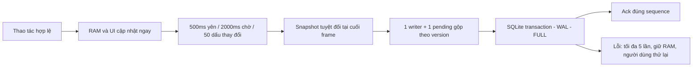

> Báo cáo checkpoint trước. Luồng ngôn ngữ hiện tại chỉ có Khởi động lại; xem [báo cáo ổn định mới](REOPEN_STABILITY_REPORT.md).

# Báo cáo dọn dẹp và sửa lỗi Green Farm 3 — 14/11/2026

## 1. Kiến trúc thực tế và phạm vi

Game là ứng dụng Android/MIDlet được khôi phục, kết hợp Java/Kotlin source với SDK/runtime DEX gốc. `FarmGameEngine` điều khiển simulation, GUI và codec; `FarmEntity` quản lý actor và hiệu ứng nhận thưởng loại47. APK gốc, resource restoration, DEX merge, đổi package/endpoint, signing và verification vẫn là chuỗi build **ứng dụng chính**, không phải chế độ offline có thể xóa.

Tiến độ farm, tiền/kho/gameplay và phần thưởng đang bay dùng SQLite cục bộ `greenfarm-progress.db`, schema4, giữ codec cũ. `PendingRewardState` giữ quyền nhận thưởng chưa hoàn tất, `EntityPoseState` giữ hướng sprite. Backend Node/MySQL giữ tài khoản anonymous, session và compliance; chưa có cloud farm save. Không chuyển tiền/kho sang backend, không đổi tài khoản, không đổi URL LAN hoặc asset gốc.

## 2. File đã xóa và thành phần được giữ

**Xóa36 file** chỉ thuộc bộ bằng chứng thử nghiệm `docs/offline-test-validation`: log/profile/metadata, smali của `OfflineTestConfig` cũ, tài liệu host và ba ảnh chụp kiểm thử cũ. Chúng không được source, Gradle hoặc runtime hiện tại tham chiếu. Ảnh chụp trong docs không phải tài nguyên đồ họa dùng bởi game. Không xóa asset, âm thanh, database, save hay khóa ký.

Danh sách đầy đủ (cùng lý do: chỉ phục vụ profile APK offline thử nghiệm đã không còn):

```
docs/offline-test-validation/balances-host/README.md
docs/offline-test-validation/balances-host/index.json
docs/offline-test-validation/balances-host/offline-balances-tests.log
docs/offline-test-validation/balances-host/offline-progress-tests.log
docs/offline-test-validation/packaging/OfflineTestConfig$Companion.smali
docs/offline-test-validation/packaging/OfflineTestConfig.smali
docs/offline-test-validation/packaging/apk-verification.json
docs/offline-test-validation/packaging/build.log
docs/offline-test-validation/packaging/compiled-offline-config.txt
docs/offline-test-validation/packaging/final-profile-proof.json
docs/offline-test-validation/packaging/offline-build-local-tests.log
docs/offline-test-validation/packaging/offline-core-profile-tests.log
docs/offline-test-validation/packaging/offline-manifest-tests.log
docs/offline-test-validation/packaging/offline-packaging-tests.log
docs/offline-test-validation/packaging/offline-profile-default.log
docs/offline-test-validation/packaging/offline-profile-offline.log
docs/offline-test-validation/packaging/offline-relocation-tests.log
docs/offline-test-validation/packaging/offline-verifier-after-build.log
docs/offline-test-validation/packaging/offline-verifier-tests.log
docs/offline-test-validation/packaging/output-metadata.json
docs/offline-test-validation/packaging/package-relocation-proof.json
docs/offline-test-validation/packaging/profile-model-results.json
docs/offline-test-validation/packaging/signature-verification.txt
docs/offline-test-validation/packaging/source-overlay-summary.json
docs/offline-test-validation/packaging/summary.json
docs/offline-test-validation/runtime/01-offline-first-farm.png
docs/offline-test-validation/runtime/02-legitimate-coin-deduction.png
docs/offline-test-validation/runtime/03-after-two-cold-reopens.png
docs/offline-test-validation/runtime/index.json
docs/offline-test-validation/startup-host/README.md
docs/offline-test-validation/startup-host/index.json
docs/offline-test-validation/startup-host/initial-ci-discovery.log
docs/offline-test-validation/startup-host/legacy-sdk-bootstrap.md
docs/offline-test-validation/startup-host/recovered-flow-after-build.log
docs/offline-test-validation/startup-host/startup-and-quest-regression.log
docs/offline-test-validation/startup-host/startup-route.log
```

Trong HEAD đầu nhiệm vụ không còn source `OfflineTestConfig`/`OfflineSession`/`OfflineTestBalances`, offline build profile hoặc workflow tương ứng; không dựng thêm việc xóa những thành phần vốn đã vắng mặt. Các chuỗi `offline_items`/`offline_store` của SDK/backend là giao thức thật, được giữ.

**Giữ** `build_binary_baseline.py`, `build_core_source.py`, `build_local_backend.py`, `MergeCoreDex.java`, Gradle/Android config và khóa `.local/baseline-debug.keystore`: các helper, pin, kiểm tra payload và packaging còn được chuỗi APK chính import/gọi. Không thể xóa theo tên “baseline/offline/local” mà không phá build hoặc online bootstrap. CLI baseline độc lập cũng được giữ vì còn là regression resource/payload và chưa xác minh là profile offline bị loại bỏ. Không xóa dependency build/SDK không chắc chắn.

## 3. File đã sửa hoặc thêm

```
README.md
app/src/main/java/com/quanhoang/greenfarm3/S800x480/FarmEntity.java
app/src/main/java/com/quanhoang/greenfarm3/S800x480/FarmGameEngine.java
app/src/main/kotlin/com/quanhoang/greenfarm3/S800x480/AsyncSaveQueue.kt
app/src/main/kotlin/com/quanhoang/greenfarm3/S800x480/GameNotification.kt
app/src/main/kotlin/com/quanhoang/greenfarm3/S800x480/GameSaveStore.kt
app/src/main/kotlin/com/quanhoang/greenfarm3/S800x480/LanguageRestartController.kt
app/src/main/kotlin/com/quanhoang/greenfarm3/S800x480/PendingRewardState.kt
app/src/main/kotlin/com/quanhoang/greenfarm3/S800x480/ProgressSaveController.kt
app/src/main/kotlin/com/quanhoang/greenfarm3/S800x480/SaveBatchPolicy.kt
backend/README.md
backend/package.json
docs/ASYNC_GAMEPLAY_CHECKPOINT.md
docs/LANGUAGE_RESTART_FLOW.md
docs/MAINTENANCE_REPORT.md
docs/maintenance-validation/results.json
tests/sqlite-host/README.md
tests/sqlite-host/build.gradle
tests/sqlite-host/settings.gradle
tests/sqlite-host/src/test/java/com/gameloft/android/wrapper/au.java
tests/sqlite-host/src/test/java/com/gameloft/android/wrapper/d.java
tests/sqlite-host/src/test/java/greenfarm/SQLiteSaveTest.java
tests/test_async_save_queue.py
tests/test_build_local_backend.py
tests/test_game_notification.py
tests/test_harvest_reward_icon.py
tests/test_inventory_save_priority.py
tests/test_pending_reward_state.py
tests/test_progress_save_controller.py
tools/prepare_core_dependencies.py
tools/test_language_restart_source.py
```

`GameNotification.kt` chỉ nối callback với GUI4 có sẵn, không phải bộ render popup mới. `tools/prepare_core_dependencies.py` chỉ thêm helper này vào registry kiểm tra số lớp; giữ nguyên các pin APK/tool và kiểm tra tính toàn vẹn. `tests/sqlite-host` là harness JVM không tạo APK, không thêm runtime offline vào game; dependency Robolectric chỉ thuộc test.

## 4. Các đường gây nghẽn đã xác định

- Khi đang chơi, SQLite đã chạy trên một writer riêng; không có bằng chứng để kết luận tất cả hiện tượng đứng là do ghi SQLite trực tiếp trong từng lần thu hoạch.
- Lịch cũ200/500ms khiến game thường mã hóa snapshot cả farm trên luồng simulation. Codec dùng buffer lớn và snapshot chứa pending reward/pose; đây vẫn là CPU/GC ở ranh giới frame, không nên đưa mutable world sang worker tùy tiện.
- Mỗi record trước đây bị SELECT và SHA-256 lại ngay trước ghi; commit snapshot lại đọc/băm các record vừa xác minh. Phần đọc lặp này được thay bằng cache durable và overlay transaction khi chính writer giữ khóa.
- Các callback Android `Pause`/`jF` gọi hàm chờ writer tới10giây nhiều lần dưới engine monitor. Đã thay bằng chụp/đẩy snapshot, không chờ SQLite trong những callback đó.
- Retry cũ tự lặp vô hạn. Đã giới hạn mỗi đợt và giữ snapshot chờ người dùng thử lại.
- `pZ()` định dạng số và tạo chuỗi ở mỗi frame của từng hiệu ứng. Đã cache theo số lượng/locale, vẫn cập nhật tọa độ mỗi frame.

Đây là nguyên nhân/đường có thể gây nghẽn xác minh được bằng code và test host. **Chưa tái hiện hiện tượng đứng khi thu hoạch trên thiết bị**, chưa có frame trace; không khẳng định đã tìm mọi nguyên nhân hoặc SQLite là nguyên nhân duy nhất. Các callback network/SDK và chi phí snapshot lớn còn cần profiling thực tế.

## 5. Kiến trúc lưu và debounce mới

Toàn bộ thông số nằm trong `SaveBatchPolicy.kt`: debounce500ms, max wait2000ms, ngưỡng50 yêu cầu/dấu thay đổi, tối đa5 lần ghi mỗi đợt; backoff250/500/1000/2000ms, busy timeout1000ms.

Gameplay vẫn cập nhật RAM và hình ảnh ngay. Mỗi thay đổi hợp lệ reset thời điểm cuối; thời điểm đầu không reset. Khi yên500ms, hoặc đã chờ2000ms, hoặc đủ50 dấu thay đổi, controller chụp snapshot ở cuối frame hoàn chỉnh. Tạo/settle pickup cũng yêu cầu lưu, không chỉ phụ thuộc boolean dirty một lần mỗi frame. Đây là **ngưỡng trigger**, không chia một hành động/frame nguyên tử thành50 SQL row; một snapshot có thể chứa nhiều actor. Mốc thời gian không phải cam kết COMMIT xong trong2000ms khi OS, frame hoặc storage bị nghẽn.



Một writer duy nhất áp dụng transaction, tối đa một snapshot đang ghi và một pending snapshot gộp theo record. Pending giữ giá trị tuyệt đối mới nhất cùng version; không xếp hàng vô hạn delta phần thưởng. Sequence xác nhận A không được xác nhận thay đổi B/C đến sau. Retry cùng snapshot không cộng lại vật phẩm/tiền; version chặn snapshot cũ ghi đè mới. Record không đổi không INSERT lại.

Prepared statement được tái sử dụng dưới khóa writer. Cache được publish sau COMMIT; transaction overlay dùng cho kiểm tra snapshot đủ record. Đường load/reopen vẫn đọc và kiểm SHA-256. Giữ WAL, `synchronous=FULL`, index/primary key hiện có và schema4; không có migration mới hoặc reset dữ liệu.

Trừ coin/cash hoặc vật phẩm kho đã được chấp nhận yêu cầu checkpoint tại frame kế tiếp, bỏ qua debounce; phần thưởng và inventory được ghi cùng farm/pending-reward state. Không gọi SQL trên callback thu hoạch, không trả thành công giả cho server. Các side effect giao dịch online vẫn theo SDK/backend cũ, chưa chứng minh end-to-end mua bán/thu thưởng online bằng các test này.

## 6. Thoát, chuyển nền và lỗi

Pause/hide chụp snapshot hoàn chỉnh và gửi worker, không `awaitIdle()` trên những callback Android. Sau hide có thể settle thưởng nên snapshot cuối vẫn được gửi. Đường thoát bình thường, unload world, ngôn ngữ và xuất save giữ barrier durable hiện có; không cho đóng writer khi còn pending. Barrier thoát/xuất save vẫn có thời gian chờ hữu hạn, không được dùng lại trong mỗi thao tác gameplay.

Sau5 lỗi ghi liên tiếp, tự động retry dừng; snapshot được giữ trong RAM và các thay đổi mới vẫn gộp vào nó. Popup game cho thử lại bằng một đợt hữu hạn mới. Checkpoint bù ngôn ngữ chưa durable giữ barrier và không cho “Để sau” bỏ qua trạng thái chưa nhất quán. Retry không phát lại hàm nhận thưởng. Test khóa writer và lỗi sau khi tất cả data row đã ghi xác nhận rollback/recovery.

**Không thể bảo đảm giữ thay đổi chưa COMMIT nếu OS kill đột ngột, hết pin hoặc tiến trình bị kết thúc trước khi worker xong.** Debounce có cửa sổ dữ liệu chỉ nằm trong RAM. `FULL`/transaction bảo vệ snapshot đã xác nhận; không biến dữ liệu RAM thành dữ liệu durable. Không có thao tác xóa dữ liệu người chơi.

## 7. Icon sữa và các vật phẩm

Đường chung item reward59 dùng `aZM[itemId]`/`aZN[itemId]` để lấy atlas/frame gốc. `sprite | Short.MIN_VALUE` sign-extend thành số âm trong Java; `oS()` chỉ gọi `aE()` khi `aoG > -1`, nên số lượng `pZ()` vẫn hiện còn icon bị bỏ qua. Sửa flag thành `0x8000` dương, giữ nguyên item ID, atlas/frame, tọa độ, zoom, clipping, lớp vẽ và quỹ đạo.

Pending reward trong save cũ cũng có thể giữ handle âm; khi restore chỉ chuẩn hóa flag15bit, không đổi số lượng, animation progress hoặc quyền nhận thưởng. Không chạy lại initializer random chest và không thay asset bằng icon chung. Cache chuỗi số lượng giảm cấp phát mỗi frame và invalidates khi lượng/locale đổi.

Test JVM chạy initializer và render gate thật với các atlas/frame khác nhau, 1/10/50/100 lượt, mỗi lượt10frame; test pending state kiểm tra nhận đúng một lần và sửa handle cũ. **Chưa chụp/quan sát icon hộp sữa, trứng, len hay cây cụ thể trên thiết bị**; chưa xác minh asset đang resident ở từng màn. Chưa phát hiện asset thiếu qua build/payload verification, nhưng không suy ra mọi texture runtime đã hiển thị đúng.

## 8. Thông báo ngôn ngữ

Bỏ `AlertDialog` khỏi `LanguageRestartController`, tái sử dụng engine20/GUI4 với font/nền/khung/nút/input gốc. Callback xử lý một lần, chặn stale tap, có tuyến Back riêng và không giành ownership popup tutorial. Popup retry chờ popup quest hiện có đóng; một pop đã yêu cầu được xử lý trước khi mở prompt kế tiếp.

Thông báo thành công chỉ xuất hiện sau checkpoint gameplay và header đã durable, bằng locale đang hiển thị. Tiếng Việt: **“Thay đổi ngôn ngữ”**, thông báo đã lưu và cần khởi động lại; nút **“Khởi động lại” / “Để sau”**. Các locale khác dùng cùng14 mã text-pack đã có. Không dùng lời “đăng xuất/đăng nhập lại” vì kiến trúc chỉ cần tạo lại MIDlet/static/font và không cần hủy tài khoản.

“Để sau” giữ UI/ngôn ngữ hiện tại; các snapshot sau chỉ vá byte4 của header tách, không đổi locale sống trong frame. Override tại storage cũng bảo vệ các lần ghi header trực tiếp từ Options/SDK, không sửa buffer của caller. Lần mở sau áp dụng lựa chọn đã lưu. Chọn lại locale đang dùng có thể hủy lựa chọn đang chờ mà không restart. “Khởi động lại” thực hiện launcher handoff sau lưu; lỗi handoff có retry riêng, không nhận thưởng hoặc lưu gameplay lần nữa. Font/wrapping/clipping và alarm thực trên thiết bị chưa được xác minh.

## 9. Kiểm thử và số đo thực tế

Kết quả chi tiết dạng máy đọc: [results.json](maintenance-validation/results.json).

| Kiểm tra đã chạy | Kết quả/phạm vi |
|---|---|
| `python3 -m unittest discover -s tests` |142 bài:127 đạt,15 skip,0 lỗi. Sau đó rerun popup/controller mới nhất đều đạt.|
| `python3 -m unittest discover -s tools -p 'test_*.py'` |20/20 đạt, gồm14-locale/source contracts.|
| `./gradlew -p tests/sqlite-host test` |8/8 đạt, không skip: native SQLite API35 trên host, không mock SQLite.|
| Backend HTTP/config và MySQL |`npm test`:25/25 đạt; `DB_NAME=green_farm_test npm run test:mysql`:10/10 đạt.|
| Native popup test |Component GUI4 và fE thật trích từ engine: idle input, không giành ownership tutorial, pop cũ xong trước prompt mới, quyết định1lần, Back/Để sau, barrier bù và14 locale đều đạt trên JVM.|
| Host action/state matrix |1/10/50/100 thay đổi, writer đang bận, debounce/max wait/50, ưu tiên trừ tiền, lifecycle capture không đợi, retry hữu hạn và newer snapshot đều đạt. Đây không phải thao tác harvest thật.|
| Native SQLite |Reopen, replay/stale order, snapshot5record, schema3→4, WAL, khóa writer rồi phục hồi, lỗi sau mọi data row rồi rollback toàn transaction đều đạt. Payload tổng hợp không được tải như farm thật.|
| APK chính |Bản cuối `assembleDebug` đạt; apksigner xác nhận v1/v2/v3 và zipalign kiểm tra alignment16KB đạt.|

Kiểm tra backend ban đầu gặp MySQL container đang dừng; đã khởi động lại cùng volume, không reset. Sau đó runner chạy hai file song song bị deadlock ở cleanup `DELETE gf_accounts` (9/10 đạt). Chạy tuần tự theo file đạt10/10; `test:mysql` được thêm `--test-concurrency=1` và README được cập nhật. Toàn bộ assertion và ca concurrent authorization nội bộ vẫn chạy, không sửa tài khoản hay logic backend.

Workload trước/sau dùng lớp storage từ HEAD gốc và bản sửa, cùng native SQLite/Robolectric API35:5 warmup rồi100transaction, mỗi transaction3record×32KiB. Không phải farm đang chơi và không phải chèn100lần thu hoạch.

| Chỉ số | HEAD trước sửa | Sau sửa |
|---|---:|---:|
| Capture p50/p95(ms) |0,102 /0,194 |0,082 /0,167 |
| Writer p50/p95(ms) |4,886 /9,211 |1,718 /6,167 |
| Transaction /changed row đo trong workload |100 /300 |100 /300 |

Đây là một mẫu đo host, có nhiễu scheduling/JIT, không phải cam kết tốc độ thiết bị. Số lần ghi bằng nhau để so sánh storage trực tiếp; phép đo này không đo hiệu quả gộp debounce. Phân tích code cho thấy workload auxiliary loại bỏ3SELECT đọc blob/batch và3 lần hash blob cũ; **chưa có SQL statement trace hoặc FPS trước/sau trong gameplay**.

## 10. Chưa thể xác minh

- Chưa chạy tương tác game: thu hoạch1/10/50/100ô, cây hỗn hợp; trồng50–100cây rồi kiểm tra thời gian phát triển; sữa/nhiều vật nuôi; animation bay vào kho; background/cold restart và popup/font trên thiết bị.
- Chưa thử gameplay mạng chậm hoặc mua/bán/nhận thưởng online. Backend chưa đồng bộ farm; các API mạng/SDK có thể còn nguyên nhân đứng ngoài SQLite.
- Máy không có `/dev/kvm`/thiết bị Android đã xác minh. SQLite host API28 native-runtime không khởi tạo được do binding đồ họa của framework test; chuyển harness sang API35 để kiểm tra storage thực. Đây không phải kiểm thử APK trên API28 hoặc thiết bị thật.
- Snapshot codec vẫn chạy trên game thread dưới engine monitor. Đã giảm cadence và I/O lặp, chưa đo capture/frame p95 trên farm lớn; không chuyển world mutable sang worker không an toàn.
- Các binary cũ trong `artifacts/` không được quảng bá như binary đã sửa. APK mới ở `app/build/outputs/apk/debug/app-debug.apk`; source/save/assets gốc được giữ.

APK cuối SHA-256: `33b9dc2dff07592920043794305c62b467d3ae7a876a3a4916e4ae45334d8799`. Không commit/publish binary hoặc thay APK gốc đầu vào.
