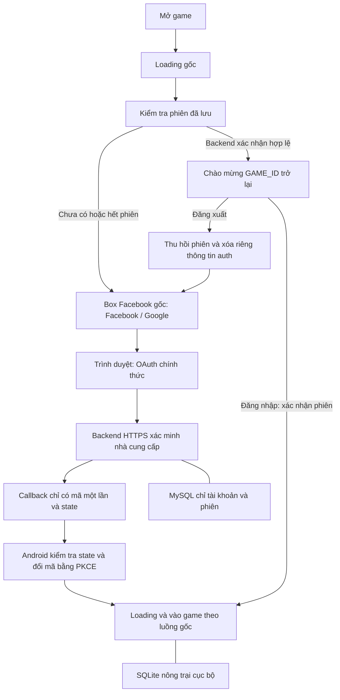

# Bàn giao tài khoản Facebook / Google

Đã triển khai mã nguồn Android, backend và website handoff; APK Debug đã build.
Đây chưa phải hệ thống OAuth đã triển khai và xác minh với tài khoản thật.
Hiện chỉ có backend local: domain HTTPS, Facebook App và Google Web OAuth Client
chưa được cung cấp. `AUTH_BASE_URL` được để trống có chủ ý; ứng dụng báo thiếu
cấu hình và không tạo phiên hoặc bỏ qua xác thực.

Yêu cầu Facebook/Google mới nhất thay thế yêu cầu form username/password trước
đó. Tài khoản được tạo ở lần xác minh nhà cung cấp đầu tiên; không có form yêu cầu
mật khẩu Facebook/Google trong game hoặc website của dự án.

## Luồng



Màn tuổi/giới tính được bỏ qua ở chế độ tài khoản mới. Giá trị cũ được giữ;
chỉ cấp giá trị runtime mặc định khi chưa có. Không gọi luồng consent cũ để
giả lập xác thực hoặc tạo token anonymous.

## UI và dữ liệu

- State 47 / GUI 29, box, hai button, hitbox, font và texture gốc được tái sử dụng.
- Nút Facebook và biểu tượng gốc giữ vị trí; nút bên phải dùng logo Google đã
  có sẵn trong resource của APK. Không thay texture gameplay hoặc engine render.
- Loading dùng lớp phủ mờ và thanh loading gốc; chặn thao tác lặp, hỗ trợ hủy,
  timeout và thử lại. Màn chào mừng ghi rõ nông trại được lưu trên thiết bị.
- Dialog chỉ cập nhật khi nội dung/trạng thái thay đổi hoặc mở lại màn hình;
  không đăng ký lại hitbox và visibility mỗi khung hình.
- Token và PKCE nằm trong preferences được mã hóa AES/GCM với Android Keystore,
  riêng với gameplay. Preferences auth được loại khỏi backup; không có fallback
  lưu token plaintext. Đăng nhập bảo mật cần Android 6.0/API 23 trở lên.
- Không đổi package/applicationId, không thay khóa ký hiện có và không đổi đường
  dẫn, schema hoặc mã `GameSaveStore` của SQLite. Không gắn GAME_ID vào chủ sở hữu
  save cũ. Các nhánh upload farm/profile legacy bị tắt ở chế độ tài khoản mới.
- Cờ chơi local và logic tiền khởi tạo vẫn độc lập: tài khoản online không kích
  hoạt phần thưởng/số dư của chế độ local.

## Cấu hình còn thiếu và cách chạy

1. Làm theo [backend/SOCIAL_AUTH.md](../backend/SOCIAL_AUTH.md) để điền `.env` từ
   [mẫu](../backend/.env.example), chạy `npm ci`, `npm run migrate`, `npm start`.
   Migration `002`/`003` chỉ thêm bảng tài khoản/phiên; không sửa migration cũ,
   không reset database.
2. Cần domain HTTPS có chứng chỉ được Android tin cậy, reverse proxy và các app
   OAuth chính thức. Secret chỉ đặt phía server. Chưa có domain/app thì API trả
   `503 oauth_not_configured`, không trả phiên giả.
3. Đặt `AUTH_PUBLIC_BASE_URL` phía server và `AUTH_BASE_URL` trong
   [gradle.properties](../gradle.properties) về cùng HTTPS origin. URL LAN cũ
   `BACKEND_BASE_URL` không phải URL xác thực mới và không thay được yêu cầu TLS.
4. Google dùng Web OAuth Client và callback `/auth/callback/google`; Facebook
   dùng callback `/auth/callback/facebook`. Package vẫn là
   `com.quanhoang.greenfarm3`. Hướng dẫn redirect, client ID, key hash và fingerprint
   nằm trong tài liệu backend và [Android](SOCIAL_AUTH_ANDROID.md).
5. Callback Android hiện dùng deep link cố định
   `com.quanhoang.greenfarm3://oauth/callback`, được bảo vệ bằng state/PKCE. Verified
   HTTPS App Links chưa được thiết lập vì chưa có domain; tài liệu chỉ rõ phần
   manifest, allowlist và `assetlinks.json` cần cấu hình khi có domain.
6. Build/cài đè với `./gradlew :app:installDebug` hoặc `gradlew.bat` trên Windows,
   dùng khóa ký cũ. Không gỡ game hoặc xóa dữ liệu để xử lý lỗi cài/đăng nhập.

Các API: `POST /auth/attempt`, `/auth/facebook`, `/auth/google`, `/auth/exchange`,
`/auth/refresh`, `/auth/logout`, và `GET /auth/me`.

Các bảng mới: `users`, `gf_auth_attempts`, `gf_auth_codes`, `gf_auth_sessions`,
`gf_auth_session_families`, `gf_auth_session_links`. Khóa duy nhất theo provider
và subject; không gộp theo email. Nội dung SQL đầy đủ:
[002](../backend/migrations/002_social_auth.sql),
[003](../backend/migrations/003_auth_session_families.sql).

## Kiểm thử và giới hạn xác minh

| Phần | Kết quả / bằng chứng |
| --- | --- |
| Backend unit/web/provider verification | 35 đạt; Google dùng token ký/JWKS fixture, Facebook dùng transport fixture **chỉ trong test**, không phải đăng nhập nhà cung cấp thật. |
| MySQL và HTTP với MySQL thật | 21 đạt, không bỏ qua: migration, restart, ID ổn định, ID BIGINT, race, rollback, code một lần, refresh và logout. |
| Android host | Lượt đầy đủ cuối cùng: 197 test, không lỗi, 1 bỏ qua do đường dẫn cache dexmerge cũ không tồn tại; pipeline build APK vẫn xác minh relocation. Log: `/workspace/.cache/social-final-full-host-tests.log`. |
| Native UI handler | Test dùng method production trích trực tiếp: vị trí/texture GUI29, button Facebook/Google, welcome, busy, READY-only entry, age defaults, cached update gate và Back. Không coi đây là bằng chứng hình ảnh trên thiết bị. |
| Lưu nông trại | Test controller/save/private restore đạt; account mode vẫn commit snapshot cục bộ, không upload, không reset tiền/reward/entity. Mã và schema gameplay SQLite không đổi. |
| APK Debug | Build thành công; pipeline kiểm tra APK thực tế, chữ ký/alignment và assets/native giữ nguyên. Bộ 15 test cho công cụ kiểm tra APK cũng đạt. |
| Native SQLite/Robolectric | Chưa hoàn tất: tải dependency chuyển hướng tới `gcp.mirrors.maven.org` bị proxy cloud chặn HTTP 403. |
| Facebook/Google thật, UI/chạm thực tế, Keystore trên thiết bị | **Chưa xác minh**: thiếu OAuth/domain và chưa có thiết bị/emulator kết nối trong môi trường. Không tuyên bố các ca đăng nhập thật đã thành công. |

Phiên nhớ chỉ vào màn chào mừng sau khi backend xác nhận. Callback giả, code hết
hạn, state sai hoặc kết quả đến sau timeout không được mở game. Đăng xuất xóa
riêng record auth và thu hồi family phiên khi có thể; nông trại cùng thiết bị
vẫn là dữ liệu local dùng chung giữa các tài khoản, không phải cloud save.

## APK và log

APK chuẩn: `app/build/outputs/apk/debug/app-debug.apk`.
Gói bàn giao trong môi trường: `.local/app-debug-social-accounts.apk`.
Gói hiện tại chưa có `AUTH_BASE_URL`, nên không thể dùng để tuyên bố OAuth đã
hoạt động thật. Cần cấu hình rồi build/cài lại.

SHA-256 của APK bàn giao:
`b16279a5a4b3c8300691b3f32b434a280e7e18cfdafd1d18178d19a4ae88b9ba`.

Lọc Logcat: `tag:GreenFarmNetwork` và `tag:GreenFarmAccount`.
Log không chứa token, mật khẩu, PKCE verifier, mã callback hoặc raw URI callback.

Fingerprint của **khóa Debug đang có trong môi trường này**, không phải khóa mới:

```text
SHA-1:   82:F2:DF:20:F5:D5:4A:FB:2E:AC:7F:95:10:5A:DC:95:4D:47:CD:7B
SHA-256: 39:6B:D4:B7:05:2E:C7:07:F8:94:51:80:AD:84:E7:3A:A9:76:F1:63:C5:33:C4:22:39:CE:FA:10:EC:45:B0:2C
```

Nếu dùng APK đã ký bằng khóa khác của bạn, hãy lấy fingerprint từ khóa đó và giữ
nguyên khóa; không thay khóa hoặc gỡ game để làm OAuth hoạt động.

## File tạo và chỉnh sửa

Danh sách chi tiết của thay đổi được ghi bên dưới.

### Android

- [app/build.gradle](../app/build.gradle)
- [app/src/main/AndroidManifest.xml](../app/src/main/AndroidManifest.xml)
- [app/src/main/java/com/quanhoang/greenfarm3/S800x480/FarmGameEngine.java](../app/src/main/java/com/quanhoang/greenfarm3/S800x480/FarmGameEngine.java)
- [app/src/main/java/com/quanhoang/greenfarm3/S800x480/s.java](../app/src/main/java/com/quanhoang/greenfarm3/S800x480/s.java)
- [app/src/main/kotlin/com/quanhoang/greenfarm3/S800x480/LocalDevelopmentMode.kt](../app/src/main/kotlin/com/quanhoang/greenfarm3/S800x480/LocalDevelopmentMode.kt)
- [app/src/main/kotlin/com/quanhoang/greenfarm3/S800x480/NetworkDiagnostics.kt](../app/src/main/kotlin/com/quanhoang/greenfarm3/S800x480/NetworkDiagnostics.kt)
- [app/src/main/kotlin/com/quanhoang/greenfarm3/S800x480/ProgressSaveController.kt](../app/src/main/kotlin/com/quanhoang/greenfarm3/S800x480/ProgressSaveController.kt)
- [app/src/main/kotlin/com/quanhoang/greenfarm3/S800x480/SecureAccountStore.kt](../app/src/main/kotlin/com/quanhoang/greenfarm3/S800x480/SecureAccountStore.kt)
- [app/src/main/kotlin/com/quanhoang/greenfarm3/S800x480/SocialAccountArtwork.kt](../app/src/main/kotlin/com/quanhoang/greenfarm3/S800x480/SocialAccountArtwork.kt)
- [app/src/main/kotlin/com/quanhoang/greenfarm3/S800x480/SocialAccountController.kt](../app/src/main/kotlin/com/quanhoang/greenfarm3/S800x480/SocialAccountController.kt)
- [app/src/main/kotlin/com/quanhoang/greenfarm3/S800x480/SocialAccountFlow.kt](../app/src/main/kotlin/com/quanhoang/greenfarm3/S800x480/SocialAccountFlow.kt)
- [app/src/main/kotlin/com/quanhoang/greenfarm3/S800x480/SocialAuthCallbackActivity.kt](../app/src/main/kotlin/com/quanhoang/greenfarm3/S800x480/SocialAuthCallbackActivity.kt)
- [app/src/main/kotlin/com/quanhoang/greenfarm3/S800x480/SocialAuthClient.kt](../app/src/main/kotlin/com/quanhoang/greenfarm3/S800x480/SocialAuthClient.kt)
- [app/src/main/kotlin/com/quanhoang/greenfarm3/Start.kt](../app/src/main/kotlin/com/quanhoang/greenfarm3/Start.kt)
- [app/src/main/res/xml/online_auth_backup_rules.xml](../app/src/main/res/xml/online_auth_backup_rules.xml)

### Backend

- [backend/.env.example](../backend/.env.example)
- [backend/README.md](../backend/README.md)
- [backend/SOCIAL_AUTH.md](../backend/SOCIAL_AUTH.md)
- [backend/migrations/002_social_auth.sql](../backend/migrations/002_social_auth.sql)
- [backend/migrations/003_auth_session_families.sql](../backend/migrations/003_auth_session_families.sql)
- [backend/package.json](../backend/package.json)
- [backend/src/auth/config.js](../backend/src/auth/config.js)
- [backend/src/auth/providers.js](../backend/src/auth/providers.js)
- [backend/src/auth/router.js](../backend/src/auth/router.js)
- [backend/src/config.js](../backend/src/config.js)
- [backend/src/db/social-store.js](../backend/src/db/social-store.js)
- [backend/src/db/store.js](../backend/src/db/store.js)
- [backend/src/main.js](../backend/src/main.js)
- [backend/src/server.js](../backend/src/server.js)
- [backend/test/auth-web.test.mjs](../backend/test/auth-web.test.mjs)
- [backend/test/config.test.mjs](../backend/test/config.test.mjs)
- [backend/test/mysql.integration.mjs](../backend/test/mysql.integration.mjs)
- [backend/test/social-auth.test.mjs](../backend/test/social-auth.test.mjs)
- [backend/test/social-http-mysql.integration.mjs](../backend/test/social-http-mysql.integration.mjs)
- [backend/test/social-mysql.integration.mjs](../backend/test/social-mysql.integration.mjs)
- [backend/web/README.md](../backend/web/README.md)
- [backend/web/assets/callback.js](../backend/web/assets/callback.js)
- [backend/web/assets/green-farm-3.png](../backend/web/assets/green-farm-3.png)
- [backend/web/assets/styles.css](../backend/web/assets/styles.css)
- [backend/web/pages.mjs](../backend/web/pages.mjs)

### Cấu hình/build/tooling

- [gradle.properties](../gradle.properties)
- [tools/PatchBackendEndpoint.java](../tools/PatchBackendEndpoint.java)
- [tools/build_local_backend.py](../tools/build_local_backend.py)
- [tools/prepare_core_dependencies.py](../tools/prepare_core_dependencies.py)

### Kiểm thử host

- [tests/test_backend_save_policy.py](../tests/test_backend_save_policy.py)
- [tests/test_build_local_backend.py](../tests/test_build_local_backend.py)
- [tests/test_core_float_dispatch.py](../tests/test_core_float_dispatch.py)
- [tests/test_local_startup.py](../tests/test_local_startup.py)
- [tests/test_local_startup_guard.py](../tests/test_local_startup_guard.py)
- [tests/test_progress_save_controller.py](../tests/test_progress_save_controller.py)
- [tests/test_social_account_artwork.py](../tests/test_social_account_artwork.py)
- [tests/test_social_account_engine.py](../tests/test_social_account_engine.py)
- [tests/test_social_account_flow.py](../tests/test_social_account_flow.py)
- [tests/test_social_auth_client.py](../tests/test_social_auth_client.py)
- [tests/test_startup_lifecycle.py](../tests/test_startup_lifecycle.py)

### Tài liệu

- [README.md](../README.md)
- [docs/SOCIAL_AUTH_ANDROID.md](../docs/SOCIAL_AUTH_ANDROID.md)
- [docs/SOCIAL_AUTH_REPORT.md](../docs/SOCIAL_AUTH_REPORT.md)
