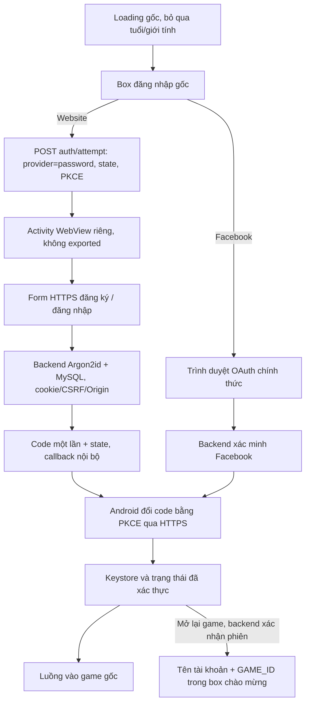

# Website Login độc lập với Facebook

Bản sửa dựa trên `origin/main` commit
`5ec1a96516cb18bafb19935e887585be38913051` (`new-fix-backend`), sau khi fetch lại
theo yêu cầu mới nhất. Các thay đổi đang làm được stash riêng, fast-forward lên
main mới và áp dụng lại sạch; không reset hoặc ghi đè công việc cục bộ.

## Nguyên nhân gốc

Không có tham số Facebook Token trong API Website `provider=password`.
Tuy nhiên có ba lớp phụ thuộc hoặc thông báo gây hiểu nhầm:

1. `backend/src/auth/config.js` kiểm tra toàn bộ Facebook/Google ngay lúc khởi
   động. Chỉ cần một provider thiếu một nửa cấu hình hoặc có giá trị sai là
   server lỗi, dù tài khoản Website không dùng provider đó.
2. Router dùng `oauth_not_configured` cho cả thiếu URL HTTPS chung. Android lại
   dịch mọi lỗi này thành thiếu ứng dụng Facebook, nên Website hiện sai nguyên
   nhân. Nay thiếu URL auth dùng `auth_not_configured`; thiếu store dùng
   `database_unavailable`; `oauth_not_configured` chỉ áp dụng khi chọn OAuth.
3. MIDlet trong DEX gốc vẫn gọi 12 callback lifecycle của adapter Facebook cũ.
   Adapter đó tự khởi tạo Facebook SDK trước khi người chơi chọn phương thức
   đăng nhập. Các lời gọi đọc profile/token trong `bt.kt` cũng có thể chạm SDK
   sau khi vào game. Các đường cũ nay dùng guard ở chế độ tài khoản mới.

Ngoài ra, main vừa cập nhật còn giữ validator IPv4 phía Node và ràng buộc cổng
HTTPS công khai phải bằng cổng HTTP local; điều này không phù hợp Cloudflare
Tunnel. `loadDatabaseConfig` còn trả password rỗng cố định thay vì `DB_PASSWORD`.
Bản sửa đọc đúng giá trị môi trường và tách cổng listener khỏi public origin.

## Luồng sau khi sửa



- Website không kiểm tra Facebook App ID, Facebook Token hoặc gọi verifier
  Facebook/Google. Facebook cấu hình thiếu/sai hoặc API Facebook lỗi chỉ ảnh
  hưởng phương thức tương ứng. Phiên chung tiếp tục dùng `/auth/me`, refresh và
  logout sau khi từng phương thức đã xác thực thành công.
- Website giữ nguyên WebView riêng: không mở Chrome, không nhận token qua
  Intent, không dùng JavaScript bridge, không bỏ qua SSL. Trang trả code/state;
  access/refresh token chỉ cấp qua `/auth/exchange` từ Android.
- Mật khẩu vẫn dùng Argon2id và bảng tài khoản/phiên hiện có. Không sửa bảng,
  migration hoặc schema MySQL trong đợt sửa này.
- Tên hiển thị chỉ lấy từ phiên được backend xác nhận. Tên chưa xác minh không
  được đưa lên UI. Box cũ dùng font metrics để vừa tên và GAME_ID trong vùng
  394×103; cache tránh đăng ký lại hitbox/animation mỗi frame. Không thêm HUD
  hoặc gắn tên vào chủ sở hữu nông trại. Đăng nhập mới vẫn tiếp tục vào game ngay;
  tên xuất hiện tại box chào mừng khi tiếp tục phiên đã nhớ.
- Logout xóa riêng auth, không xóa SQLite. `GameSaveStore.kt` và
  `ProgressSaveController.kt` không thay đổi so với main mới.

## Bản APK thực tế và Facebook SDK cũ

`javax/microedition/midlet/MIDlet.java` trong repository là bản tham chiếu, không
thuộc tập source biên dịch lõi. Vì vậy chỉ sửa file này chưa đủ để sửa APK.

Pipeline hiện biên dịch `LegacyFacebookLifecycle.kt` và thay đúng 12 reference
`invokestatic` của MIDlet DEX sang helper. Opcode, register, proto, branch,
exception/debug metadata và các module lifecycle khác được giữ nguyên. Tool
đọc lại DEX và đảo patch để đối chiếu canonical bytecode với bản gốc; đóng gói
bắt buộc có proof và helper đủ 12 phương thức.

Ở `ONLINE_ACCOUNTS=true`, helper không chạm SDK cũ; `bt.kt` dùng các giá trị
disabled vốn có thay vì đọc Facebook Token/profile. Facebook hiện tại vẫn dùng
`SocialAccountController` → OAuth browser → backend, nên không cần lifecycle
SDK cũ. Khi `ONLINE_ACCOUNTS=false`, helper và adapter giữ nguyên hành vi legacy.

## Cấu hình URL

`BACKEND_BASE_URL` hỗ trợ origin HTTP/HTTPS có DNS, tên máy local, IPv4, IPv6
trong ngoặc vuông và cổng tùy chọn. `AUTH_BASE_URL` và `AUTH_PUBLIC_BASE_URL`
vẫn yêu cầu HTTPS. Các parser không tự resolve DNS hoặc đổi numeric IP alias.
Không nhận userinfo, path khác `/`, query hoặc fragment vì API auth dùng route
gốc cố định và không được làm rò thông tin nhạy cảm trong cấu hình.

Ví dụ cú pháp hợp lệ:

```text
https://accounts.example.com/
https://accounts.example.com:9443/
http://greenfarm-dev:8787/
http://127.0.0.1:8787/
https://[2001:db8::1]:9443/
```

Địa chỉ trong hai property hiện tại lấy từ main người dùng vừa push:

```properties
BACKEND_BASE_URL=https://ipaq-gentle-acquisition-sacred.trycloudflare.com
AUTH_BASE_URL=https://ipaq-gentle-acquisition-sacred.trycloudflare.com
```

Phía server dùng `.env` riêng:

```dotenv
HOST=127.0.0.1
PORT=8787
AUTH_PUBLIC_BASE_URL=https://ipaq-gentle-acquisition-sacred.trycloudflare.com
AUTH_TRUSTED_PROXY_IP=127.0.0.1
LEGACY_AUTH_ENABLED=false
```

Điền `DB_*` đúng môi trường. Chỉ đặt `RESEARCH_SESSION_SECRET` khi bật phiên
legacy. Giữ mật khẩu ở backend. Cổng `PORT` chỉ là HTTP listener local, độc lập cổng public
của proxy/tunnel. Proxy phải ghi đè forwarded headers, chứng chỉ HTTPS phải hợp
lệ. Google/Facebook ID/secret có thể để trống khi chỉ dùng Website. Cấu hình
Facebook hợp lệ vẫn được dùng khi người chơi chọn Facebook.

Khi URL tunnel đổi, cập nhật cả hai property cùng `AUTH_PUBLIC_BASE_URL`, restart
backend, build và cài đè APK với khóa cũ. Thay URL không reset nông trại.

## Kiểm thử và giới hạn

| Phần | Kết quả |
| --- | --- |
| Backend unit/web/config/provider | 65 đạt, không bỏ qua; Website chạy khi OAuth chưa cấu hình, cấu hình lỗi hoặc provider ném lỗi. |
| MySQL/HTTP | 34 đạt, không bỏ qua; đăng ký/login/restart/me/refresh/logout và Facebook/Google regressions trên database test thật. |
| Android/tooling host | 209 test: 208 đạt, 1 bỏ qua, không lỗi (295.531 giây). Test relocation dùng cache cũ bị bỏ qua; pipeline APK thực tế vẫn kiểm tra relocation. |
| APK Debug | Build thành công; chữ ký v1/v2/v3 và alignment hợp lệ. Provenance xác nhận 12 lời gọi lifecycle được đổi reference, helper đủ phương thức và reverse proof đạt. 59 mục assets/native giữ nguyên. |

Các test Website đặt verifier OAuth ở trạng thái ném lỗi nếu bị gọi; đăng ký,
đăng nhập, nhớ phiên, refresh và logout vẫn phải thành công khi Facebook thiếu
cấu hình, cấu hình sai hoặc gặp lỗi. SDK adapter/lifecycle tests cũng dùng class
SDK ném lỗi khi được khởi tạo ở online mode và xác nhận legacy mode vẫn hoạt động.

URL thật đã đóng; theo yêu cầu người dùng không tiếp tục kiểm tra live và không
coi khả năng kết nối đã được xác minh. Kiểm thử HTTP/MySQL dùng database thật
riêng cho test và mô phỏng boundary đã qua TLS, không phải một deployment HTTPS
Internet. Chưa có thiết bị/emulator kết nối để xác minh WebView, bàn phím, FPS,
Keystore, Facebook tài khoản thật hoặc SQLite của bản cài thực tế.

## APK và bằng chứng

APK chuẩn: `app/build/outputs/apk/debug/app-debug.apk`.
Bản bàn giao: `.local/app-debug-independent-website-auth.apk`.

SHA-256: `68b47ba6c5b19f2718ad7b6bdb163ef15e61df683cdd9c6894602da8ae8b5991`.

Các log trong môi trường kiểm thử:

- `/workspace/.cache/website-independent-final-build.log`
- `/workspace/.cache/website-independent-final-host-tests.log`
- `/workspace/.cache/website-all-backend-unit-tests.log`
- `/workspace/.cache/website-all-mysql-tests.log`
- `/workspace/.cache/website-independent-android-tests.log`
- `/workspace/.cache/legacy-facebook-lifecycle-dex-tests.log`
- `/workspace/.cache/website-independent-apk-signature.log`

## File thay đổi

Tổng cộng 35 file tạo hoặc sửa so với main `5ec1a96`. Không có migration mới.

### Android

- [app/build.gradle](../app/build.gradle)
- [app/src/main/java/com/quanhoang/greenfarm3/S800x480/FarmGameEngine.java](../app/src/main/java/com/quanhoang/greenfarm3/S800x480/FarmGameEngine.java)
- [app/src/main/java/javax/microedition/midlet/MIDlet.java](../app/src/main/java/javax/microedition/midlet/MIDlet.java)
- [app/src/main/kotlin/com/quanhoang/greenfarm3/S800x480/LegacyFacebookLifecycle.kt](../app/src/main/kotlin/com/quanhoang/greenfarm3/S800x480/LegacyFacebookLifecycle.kt)
- [app/src/main/kotlin/com/quanhoang/greenfarm3/S800x480/SocialAccountController.kt](../app/src/main/kotlin/com/quanhoang/greenfarm3/S800x480/SocialAccountController.kt)
- [app/src/main/kotlin/com/quanhoang/greenfarm3/S800x480/SocialAccountFlow.kt](../app/src/main/kotlin/com/quanhoang/greenfarm3/S800x480/SocialAccountFlow.kt)
- [app/src/main/kotlin/com/quanhoang/greenfarm3/S800x480/bt.kt](../app/src/main/kotlin/com/quanhoang/greenfarm3/S800x480/bt.kt)

### Backend

- [backend/EMBEDDED_AUTH.md](../backend/EMBEDDED_AUTH.md)
- [backend/README.md](../backend/README.md)
- [backend/src/auth/config.js](../backend/src/auth/config.js)
- [backend/src/auth/router.js](../backend/src/auth/router.js)
- [backend/src/backend-url.js](../backend/src/backend-url.js)
- [backend/src/config.js](../backend/src/config.js)
- [backend/test/config.test.mjs](../backend/test/config.test.mjs)
- [backend/test/password-http-mysql.integration.mjs](../backend/test/password-http-mysql.integration.mjs)
- [backend/test/provider-config-isolation.test.mjs](../backend/test/provider-config-isolation.test.mjs)
- [backend/test/social-auth.test.mjs](../backend/test/social-auth.test.mjs)

### Build và công cụ

- [buildSrc/src/main/groovy/greenfarm/BackendBaseUrl.groovy](../buildSrc/src/main/groovy/greenfarm/BackendBaseUrl.groovy)
- [buildSrc/src/main/groovy/greenfarm/MergeOriginalSdkApk.groovy](../buildSrc/src/main/groovy/greenfarm/MergeOriginalSdkApk.groovy)
- [gradle.properties](../gradle.properties)
- [tools/PatchBackendEndpoint.java](../tools/PatchBackendEndpoint.java)
- [tools/build_local_backend.py](../tools/build_local_backend.py)
- [tools/prepare_core_dependencies.py](../tools/prepare_core_dependencies.py)

### Kiểm thử host

- [tests/test_backend_base_url.py](../tests/test_backend_base_url.py)
- [tests/test_backend_endpoint_patch.py](../tests/test_backend_endpoint_patch.py)
- [tests/test_build_local_backend.py](../tests/test_build_local_backend.py)
- [tests/test_embedded_account_controller.py](../tests/test_embedded_account_controller.py)
- [tests/test_legacy_facebook_lifecycle.py](../tests/test_legacy_facebook_lifecycle.py)
- [tests/test_legacy_facebook_lifecycle_patch.py](../tests/test_legacy_facebook_lifecycle_patch.py)
- [tests/test_legacy_social_adapter.py](../tests/test_legacy_social_adapter.py)
- [tests/test_social_account_engine.py](../tests/test_social_account_engine.py)
- [tests/test_social_account_flow.py](../tests/test_social_account_flow.py)

### Tài liệu

- [README.md](../README.md)
- [docs/EMBEDDED_AUTH_REPORT.md](../docs/EMBEDDED_AUTH_REPORT.md)
- [docs/WEBSITE_AUTH_ISOLATION.md](../docs/WEBSITE_AUTH_ISOLATION.md)
