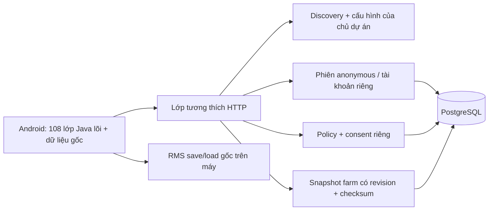

# Backend độc lập — thiết kế và phạm vi mốc Accept

Mục tiêu mới: chơi lâu dài với backend và cơ sở dữ liệu do chủ dự án quản lý,
không dùng dịch vụ/tài khoản Gameloft. Checkpoint ứng dụng trước thay đổi là
`ce19d54`. Thiết kế được trình bày trước khi triển khai mốc local đầu tiên;
không coi kế hoạch các mốc sau là chức năng đã hoạt động.

## Bằng chứng làm cơ sở

- EVE cung cấp danh sách datacenter và URL dịch vụ. Auth/privacy nằm sau service
  discovery, không phải một response duy nhất tại EVE.
- `ci.Dt()V` kiểm tra tuổi, `qO()` (kết nối mobile/Wi-Fi) và `a.fZ()` (Janus
  readiness). Smali gốc `ci:39955–40102` xác nhận lỗi readiness quay lại mà chưa
  chấp nhận tuổi. `a.Ne` chỉ được đặt sau discovery và authorize.
- Privacy gửi form token/country/age; client đọc các policy object có
  `compliant`. Response rỗng `{}` có nhánh đặc biệt nhưng không được chọn làm
  chính sách thử nghiệm. HTTP200 mới đi vào callback privacy; 202 không tương
  đương 200 ở đây.
- Nông trại khởi đầu được tạo từ pack `/14`; XP, tiền, nhiệm vụ và entity có
  serialization RMS cục bộ. Chưa có bằng chứng mọi thao tác kinh tế đều do
  server xác nhận. Cloud save và hàng xóm là các đường riêng.

Tham chiếu: [hợp đồng bytecode](ACCEPT_PROTOCOL_EVIDENCE.md),
[inventory](NETWORK_INVENTORY.md), [ranh giới dữ liệu](GAME_STATE_BOUNDARY.md).
Các mô tả parser là bằng chứng client; không khẳng định biết triển khai server gốc.

## Kiến trúc dự kiến

Một ứng dụng Node.js/TypeScript chia module là đủ ở giai đoạn đầu; chưa cần
microservice, queue hoặc Kubernetes. Lớp tương thích giữ định dạng mà client
thực sự đọc. Core gameplay tiếp tục chạy trên máy. Không triển khai API giả
cho tất cả URL trong APK hoặc giả thành công cho endpoint chưa phân tích.

`PUBLIC_BASE_URL` cấu hình toàn bộ địa chỉ do server trả về. M0 dùng
`http://10.0.2.2:8787` trong emulator, server bind loopback trên host. Không có
tên miền thật được giả định. Triển khai thật dùng hostname của chủ dự án và
HTTPS với chứng chỉ được Android tin cậy. Manifest gốc đã cho phép cleartext;
mốc local không sửa TLS trust hoặc tắt kiểm tra chứng chỉ.

## API tối thiểu M0 — tương thích đã có bằng chứng

| API | Request | Response client tiêu thụ |
|---|---|---|
| `GET /config/{client}/datacenters` | Không token/body | Mảng không rỗng, phần tử đầu có `name`, `_datacenter_id` dạng string |
| `GET /config/{client}/datacenters/{name}/urls` | Không token/body | Mười key string: `pandora`, `gllive-ope`, `tapjoy`, `offline_items`, `game_portal`, `status`, `crm_iap`, `ads_agency`, `marketing_site`, `online_connectivity` |
| `GET /locate/auth` | Không token/body | Base URL thuần văn bản, không JSON quote hoặc newline |
| `POST /authorize` | Form `client_id`, `username`, `password`, `scope`, `device_id` | Object có `access_token` string do backend mới phát hành |
| `POST /users/me/compliance` | Form `access_token`, `country`, `age` | Object policy-name → object có `compliant` boolean; trả HTTP200 cho kết quả hợp lệ |

`GET /healthz` là API vận hành **mới**, không khôi phục từ APK.
`devices/mydevice` và `configs/users/me` có bằng chứng wire nhưng không thuộc
đường đặt readiness; payload config cấp cao chưa đủ để triển khai đúng. M0 trả
lỗi rõ ràng cho chức năng chưa hỗ trợ. Không tự tạo schema config/kinh tế/IAP.

Policy M0 `LOCAL_RESEARCH_16_PLUS` là quy tắc nghiên cứu mới, chỉ cho phép từ16
tuổi theo cấu hình thử nghiệm; kiểm thử chính dùng tuổi30. Không tự nhận là
chính sách Gameloft hoặc bảo đảm pháp lý theo quốc gia. Client vẫn thực thi
những nhánh tuổi/country đã có. Cần kiểm thử riêng trường hợp không compliant
trước khi dùng ngoài môi trường local: checker gốc trả callback success với
age0, trong khi một số caller còn dựa trên tuổi người dùng đã nhập.

## Xác thực và dữ liệu bền vững

M0 không gọi upstream. Server kiểm tra định dạng anonymous/password dẫn xuất
mà client gốc gửi rồi phát hành token riêng có hạn dùng, ký bằng secret riêng.
Credential tương thích này không phải cơ chế bảo vệ tài khoản sản xuất:
password gốc được suy ra từ credential, không chứng minh quyền sở hữu an toàn.
M0 chỉ lưu phiên trong RAM và chưa có tài khoản/cloud save bền vững.

Mốc tài khoản sẽ thêm installation keypair hoặc phương thức đăng nhập mới,
token rotation/revocation và migration có kiểm thử. Không dùng tài khoản,
token hay server xác thực Gameloft làm nguồn quyền sở hữu.

Schema PostgreSQL **đề xuất mới**, không phải schema server gốc:

| Bảng | Vai trò |
|---|---|
| `accounts` | UUID người chơi do hệ thống mới quản lý |
| `installations` | Liên kết account, khóa công khai thiết bị và trạng thái đăng ký |
| `sessions` | Hash token/refresh token, hạn dùng, thu hồi |
| `consents` | Phiên bản policy, quyết định, thời điểm, thông tin tối thiểu cần thiết |
| `farm_snapshots` | Account/slot, revision, format version, SHA-256 và payload binary nguyên vẹn |

Ban đầu snapshot là dữ liệu gốc có phiên bản, không chuyển các array chưa giải
mã thành bảng vật phẩm đoán. Level, nhiệm vụ, tiền và inventory được giữ trong
payload; bảng projection/ledger chỉ thêm khi codec và quyền cập nhật đã chứng
minh bằng bytecode + test. Dùng revision/optimistic concurrency để tránh một
thiết bị ghi đè save mới của thiết bị khác. Phục hồi qua thiết bị khác phải xử
lý identity binding bằng migration tương đương đường cloud gốc, không bỏ CRC,
checksum hoặc kiểm tra device-id tùy tiện.

API account/snapshot/inventory mới sẽ được thiết kế ở mốc tương ứng; chúng
chưa có wire contract trong M0 và không được liệt kê là API gốc đã khôi phục.

## Thay đổi APK và giới hạn của M0

Tạo artifact riêng `app-local-backend-debug.apk`. Chỉ đổi một literal discovery
URL trong `Lcom/gameloft/a/b/a;->aL(Ljava/lang/String;)Ljava/lang/String;`.
Patcher kiểm tra đúng một instruction; mọi class khác phải giữ canonical DEX,
và reverse-patch class bị đổi phải khớp bản trước. Không sửa các cờ readiness,
callback, tuổi, CRC, integrity hoặc dữ liệu game. Metadata kích thước DEX được
tính lại bằng pipeline đã kiểm thử, rồi ký cùng khóa debug cục bộ.

Các client mạng legacy khác chưa được di chuyển. Vì vậy M0 **chưa đạt mục tiêu
không còn mọi request Gameloft**. Inventory và log mốc này làm danh sách cho
mốc thay thế tiếp theo; không đánh đồng việc Janus dùng local với toàn game
đã độc lập hoàn toàn.

## Mốc, kiểm thử và checkpoint

1. **M0 phân tích + Accept:** lưu evidence/contract; test HTTP thật của backend;
   build riêng; emulator kiểm tra discovery/auth/privacy và state tiếp theo.
   Không tuyên bố vào farm nếu chưa thấy farm thực tế.
2. **M1 gameplay local:** di chuyển, trồng/thu hoạch, nhiệm vụ, kho; save tại
   điểm đủ điều kiện của logic gốc; force-stop/relaunch và so sánh tiến trình.
3. **M2 tài khoản + PostgreSQL + snapshot:** sở hữu, upload/download, conflict,
   khôi phục giữa hai installation; migration không mất dữ liệu.
4. **M3 online:** phân tích rồi thay profile/hàng xóm/social/IAP cần thiết; các
   chức năng bỏ/thay phải ghi rõ khác biệt. Không giả receipt mua hàng thành công.
5. **M4 độc lập lâu dài:** log/kiểm thử deny external network, không request
   Gameloft/SDK đã ngừng dùng; backup DB, nâng phiên bản save, Android mới.

Chỉ chạy lại build/test bị ảnh hưởng. Tái dùng 108 core và81 test cũ; không
chạy lại tất cả trong mỗi lần đổi fixture backend. Mỗi mốc lưu commit/checkpoint
với hash APK, log server và trạng thái: đã chạy thực tế / chỉ build / chưa test.
